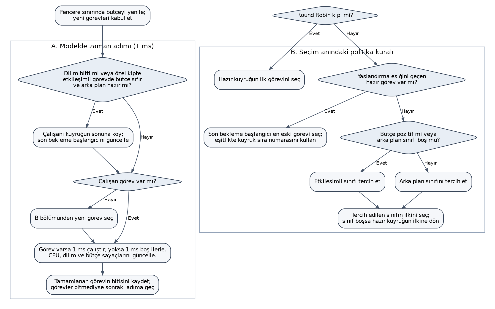
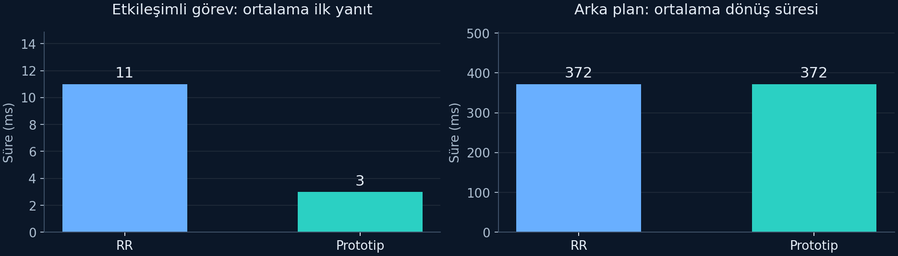
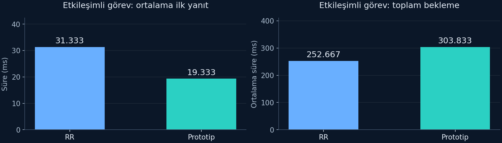

# ARAŞTIRMA ÖNERİSİ FORMU

## A. GENEL BİLGİLER

| Alan | Bilgi |
|---|---|
| Proje başlığı | Gecikme Odaklı CPU Zamanlama |
| Proje yürütücüsü | Burak Şanlı |
| Üniversite / bölüm | Harran Üniversitesi / Bilgisayar Mühendisliği |
| Akademik danışman | Prof. Dr. Dursun Akaslan |
| Başvuru türü | Bireysel |
| Proje süresi | 6 ay |


# ÖZET

CPU yoğun arka plan işleriyle birlikte çalışan kısa görevlerin yanıt süresi, uzun işlerin ilerlemesi ve zamanlama maliyeti birlikte değerlendirilmesi gereken bir kaynak paylaşımı problemidir. Bu projenin amacı, sabit pencereye bağlı sınırlı etkileşimli tercih bütçesiyle yaşlandırmayı birleştiren CPU zamanlama politikasını geliştirmek ve hangi yüklerde yararlı veya yetersiz olduğunu belirlemektir. Katkı, mevcut adil zamanlama altyapısını bütünüyle değiştirme iddiasından ziyade açık görev sınıfları için gecikme–ilerleme dengesinin uygulanması ve kontrollü ölçümüdür.

Altı aylık çalışma; test ortamının doğrulanması, referans modelin genişletilmesi, uygun çekirdek altyapısında politika uygulaması ve tekrarlanabilir karşılaştırmalardan oluşmaktadır. Ön çalışmada C modeli, gerçek süreç ölçüm aracı ve 13 başarılı test yöntemi hazırlanmıştır. Modelde karışık yükün ilk yanıtı iyileşirken yoğun etkileşimli yükün toplam beklemesi artmıştır. Özel politika henüz çekirdeğe yüklenmemiştir; ön bulgular gerçek Linux performans artışı olarak sunulmamaktadır.

Ana deney tasarımında üç yük ailesi iki yoğunluk düzeyinde incelenecektir. Varsayılan ve özel politika, hücre başına en az 10 eşleştirilmiş blokla toplam en az 120 koşuda karşılaştırılacaktır. Kısa görev içeren dört hücredeki 80 koşuda en az 1.000'er kısa görev gözlemi toplanacak; saf arka planın iki hücresindeki 40 koşuda sabit iş miktarının tamamlanması ve işlem hacmi ölçülecektir. Gecikme koşularında arka plan yükü bütün gözlem penceresi boyunca sürdürülecektir. P95 gecikme, ilerleme ve maliyet birlikte analiz edilecek; koşul sırası kontrol edilerek belirsizlik ve olumsuz sonuçlar raporlanacaktır.

Proje yönetimi beş ölçülebilir iş adımı ve doğrulanabilir geri dönüş planına dayanmaktadır. Mevcut kişisel bilgisayar ve açık kaynak araçları kullanılacak; ek ekipman veya ücretli hizmet alımı planlanmayacaktır. Beklenen çıktılar, test edilmiş politika prototipi, sürümlendirilmiş iş yükleri ve deney kayıtları, bileşen etkilerini açıklayan karşılaştırmalar ve yeniden üretim belgeleridir. Sonuçların sistem programlama eğitimi ve sonraki kaynak yönetimi araştırmaları için kullanılabilir bir değerlendirme altyapısı sağlaması hedeflenmektedir.

Anahtar kelimeler: CPU zamanlama, etkileşimli görev, yaşlandırma, kaynak paylaşımı, deneysel değerlendirme.

# 1. ARAŞTIRMA ÖNERİSİNİN BİLİMSEL NİTELİĞİ

## 1.1. Konunun Önemi ve Araştırma Önerisinin Bilimsel Niteliği

CPU zamanlama, etkileşimli görevlerin kısa sürede yanıt vermesiyle uzun hesaplama işlerinin ilerlemesini birlikte etkiler. İlk yanıt, toplam bekleme, tamamlanma süresi, kaynak paylaşımının adaleti ve zamanlama maliyeti aynı ölçüt değildir. Bu araştırma, mevcut sistemlerin kısa görevlere hiç destek vermediği veya adalet mekanizmasının bulunmadığı iddiasına dayanmamaktadır.

CFS tasarımı görev ağırlıklarını ve sanal çalışma zamanını temel alarak adil paylaşımı ele alır (Linux Kernel Community, 2024a). EEVDF, uygunluk ve sanal son teslim zamanı üzerinden adil sınıfta görev seçimini düzenler (Linux Kernel Community, 2024b). sched_ext ise başlı başına yeni bir zamanlama algoritması değil, BPF programlarıyla politika geliştirilebilen bir çekirdek altyapısıdır (Linux Kernel Community, 2024c; 2024d). İncelenen scx_simple örneğinin varsayılan davranışı ağırlıklı sanal zaman seçimidir; FIFO kipi ayrıca etkinleştirilir. Aynı örneğin kaynak açıklaması, CPU yoğun görevlerin FIFO kipinde etkileşimli görevleri geride bırakabildiğini belirtmektedir (Linux Kernel Community, 2024c; 2024d). Bu ayrım, karşılaştırmada hem politika kurallarının hem kullanılan çerçevenin açıkça tanımlanmasını gerektirir.

Bu projenin ele aldığı somut sorun, açıkça belirtilen kısa/periyodik görevlerle CPU yoğun uzun görevlerin aynı işlemciyi paylaştığı koşullarda, kısa görevlere verilen tercihin ne zaman yararlı olduğu ve bunun uzun görevlerin ilerlemesine hangi maliyeti getirdiğidir. Önerilen politika, sabit zaman penceresi içindeki sınırlı etkileşimli tercih bütçesini son bekleme başlangıcına dayalı yaşlandırmayla birleştirir. Mevcut adil zamanlayıcının genel kaynak paylaşımı hedefini yeniden tanımlamak yerine, iki görev sınıfı için açık bir gecikme–ilerleme denge kuralını araştırır. Bütçe ve yaşlandırmanın tek tek etkileri, aynı altyapıda bu bileşenlerin kaldırıldığı ek kontrol sürümleriyle incelenecektir.

Araştırma sorusu şöyledir: Sınırlı tercih bütçesi ve yaşlandırma kullanan politika, tanımlı karma yüklerde kısa görevlerin P95 uyanma gecikmesini azaltırken arka plan ilerlemesini ve tamamlanmasını önceden belirlenen sınırlar içinde koruyabilir mi? Araştırma hipotezi, bunun bazı karma yük koşullarında sağlanabileceği; yoğun talepte ise bütçe, ilk yanıt ve toplam bekleme arasında ölçülebilir ödünleşimler oluşacağıdır. Evrensel üstünlük veya literatürde ilk algoritma olma iddiası kurulmamaktadır.

Ön çalışmadaki modelde karışık yükün ortalama ilk yanıtı 11 ms'den 3 ms'ye inerken, yoğun etkileşimli yükte toplam ortalama bekleme 252,667 ms'den 303,833 ms'ye yükselmiştir. Bu karşı örnek, birinci çalışmaya erişim ile bütün işin bitişini birlikte inceleme gereğini somutlaştırmaktadır. Bilimsel katkı; kural bileşiminin gerçek çekirdekte uygulanması, varsayılan davranışla eşleştirilmiş ölçümü, tekil bileşen kontrolleri ve yararlı/zararlı yük koşullarının açıklanmasıdır. İlk sürüm açık görev sınıfları ve tek ölçüm CPU'suyla sınırlıdır; otomatik sınıflandırma, genel çok çekirdek yerleşimi, bellek ve termal yönetim temel hedef değildir.

### Literatür karşılaştırması ve araştırmanın konumu

Zamana duyarlı görevlerin gecikmesi yalnız görev seçimine bağlı değildir. Goel vd. (2002), Time-Sensitive Linux çalışmasında yüksek hassasiyetli zamanlayıcıları, çekirdeğin kesilebilirliğini ve uygun CPU zamanlamasını birlikte ele almış; etkileşimli/zamana duyarlı uygulamalarla işlem hacmi odaklı uygulamaların birlikte değerlendirilmesi gerektiğini göstermiştir. Bu çalışma bizim kullandığımız çekirdek veya politikanın güncel performansını kanıtlamaz. Araştırmada uyanma gecikmesinin saf hazır-kuyruk beklemesi olarak adlandırılmaması ve gecikmenin yanında arka plan ilerlemesinin ölçülmesi bu ayrımı korur (Goel vd., 2002).

Bütçe kullanımı da tek başına yeni bir zamanlama fikri değildir. Linux SCHED_DEADLINE, EDF seçimini Constant Bandwidth Server ile birleştirir; görev çalışma bütçesi, periyot ve son teslim zamanı ile uygun kabul kontrolü üzerinden kaynak yalıtımı sağlar. Bu projedeki sınıf tercihi bütçesi aynı garantiye sahip değildir: yaşlandırma ve tek sınıfın hazır olması istisnaları vardır, görev başına son teslim zamanı veya kabul kontrolüne dayalı süre garantisi verilmez (Linux Kernel Community, 2024e).

Çizelge 1. İncelenen yaklaşımlarla araştırmanın kapsam karşılaştırması.

| Yaklaşım / kaynak | Temel yaklaşım | Bu projedeki karşılığı ve sınırı |
|---|---|---|
| Time-Sensitive Linux (Goel vd., 2002) | Zamanlama, timer hassasiyeti ve çekirdek kesilebilirliğinin birlikte ele alınması | Uyanma ölçümünün birden fazla sistem etkisini kapsadığı kabul edilir. TSL'nin sonuçları bizim politikamızın kazancı olarak kullanılmaz. |
| CFS ve EEVDF (Linux Kernel Community, 2024a; Linux Kernel Community, 2024b) | Ağırlıklar, sanal zaman, uygunluk ve sanal son teslim zamanı | Gerçek deneyin varsayılan adil sınıfı bir karşılaştırma koludur. Mevcut RR modeli bu algoritmaların benzetimi değildir. |
| EDF/CBS (Linux Kernel Community, 2024e) | Görev bütçesi, periyot, son teslim zamanı ve kabul kontrolü | Bizim sınıf tercihi bütçemiz kaynak rezervasyonu veya gerçek zaman garantisi sayılmaz. SCHED_DEADLINE bu projede uygulanmış karşılaştırma kolu değildir. |
| sched_ext ve scx_simple (Linux Kernel Community, 2024c; Linux Kernel Community, 2024d) | BPF ile politika geliştirme altyapısı ve örnek seçim kuralları | Aynı altyapıdaki FIFO ve bileşen çıkarma kontrolleri karar kurallarını incelemeye yardım eder. Altyapı başlı başına yeni algoritma değildir. |
| Önerilen çalışma | Sınırlı sınıf tercihi bütçesi, bekleme yaşlandırması ve kontrollü eşleştirilmiş deney | Açık iki sınıf ve tek ölçüm CPU'sunda yararlı/zararlı koşullar belirlenir; evrensel üstünlük veya literatürde ilk olma iddiası kurulmaz. |

Bu kaynakların hiçbiri bütün literatürün tarandığı anlamına gelmez. Projenin savunulabilir katkısı, bilinen mekanizmaların bu tanımlı görev kümesindeki birleşimini açıklamak, uygun çekirdekte uygulamak ve bileşenleri ayrı ayrı sınayan yeniden üretilebilir bir değerlendirme sunmaktır. Parametreler, olumsuz yük koşulları ve uygulama maliyeti açıkça raporlanacaktır. Böylece teknik uygulama ile araştırma sorusu birbirine bağlanır.

### Araştırma sorusu ve sınanacak hipotezler

H1: Birincil seyrek karma koşulda özel politika, varsayılan sınıfa göre kısa görevlerin koşu bazındaki P95 uyanma gecikmesini azaltabilir; arka plan ilerleme sınırı aynı anda sağlanmalıdır.

H2: Yoğun etkileşimli talepte ilk yanıt, toplam bekleme ve arka plan ilerlemesi farklı yönlerde değişebilir. Ön çalışmadaki olumsuz örnek bu hipotezi araştırmaya gerekçe sağlar, gerçek çekirdek sonucunu önceden belirlemez.

H3: Bütçe ve yaşlandırma bileşenlerinden birinin kaldırılması, tam politikaya göre gecikme–ilerleme dengesini değiştirebilir. Etkinin yönü önceden olumlu kabul edilmez; bileşenlerin katkısı eşleştirilmiş ek koşularla incelenir.

## 1.2. Amaç ve Hedefler

Amaç, bütçe ve yaşlandırma tabanlı politika kurallarını denetlenebilir referans modelden gerçek çekirdek deneyine taşıyarak gecikme, ilerleme ve uygulama maliyeti arasındaki dengeyi belirlemektir. Altı aylık çalışmanın ölçülebilir hedefleri şunlardır:

1. Birinci iş adımında hedef çekirdeğin tam sürümünü ve yapılandırmasını, BPF/BTF araçlarını, yükleme yetkilerini ve geri yüklenebilir test ortamını kaydetmek; örnek politikanın yüklenmesi, kaldırılması ve varsayılan zamanlamaya dönüşünü üç ardışık denemede doğrulamak.
2. İkinci adımda görev kabulü, kuyruk sırası, bütçe yenilenmesi, yaşlandırma ve istisnaları tanımlanmış modeli genişletmek; üç iş yükü ailesini ve sınır/karşı örnekleri oluşturmak.
3. Üçüncü adımda aynı kuralları uygun sched_ext altyapısında uygulamak; görev bitişi, sayaç tutarlılığı, sınıf kabulü, bütçe muhasebesi ve güvenli geri dönüş dahil toplam en az 25 test yöntemi veya ayrı kayıtlı doğrulama senaryosu hazırlamak. Mevcut 13 test bu hedefin ön çalışma kısmıdır; kalan testler yapılmış kabul edilmez.
4. Dördüncü adımda üç aile ve iki yoğunluk düzeyinden oluşan altı hücrede en az 10 eşleştirilmiş blok yürütmek: varsayılan ve özel politika için toplam en az 120 ana koşu. Bunların 80'i kısa görev içeren gecikme koşusu, 40'ı saf arka plan koşusudur. Yalnız 80 gecikme koşusunun her birinde en az 1.000 kısa iş gözlemi toplanacaktır.
5. Beşinci adımda seçili karma yüklerde FIFO referansı ve bütçesiz/yaşlandırmasız sürümlerle ek kontroller yapmak; bütün ana hücrelerde olumlu ve olumsuz bulguları, belirsizliği, ilerleme kaybını ve maliyeti birlikte raporlamak.

Öncelikli gecikme ölçütü, kısa görev içeren koşulardaki P95 uyanma gecikmesidir. Saf arka plan koşularında kısa görev bulunmadığından bu ölçüt hesaplanmaz. Bu hücrelerde sabit iş miktarının tamamlanma süresi ve işlem hacmi kullanılır. Başlangıç mühendislik hedefi, önceden seçilmiş karma yükte P95 gecikmenin en az yüzde 20 azalması ve uzun işlerde koruyucu ilerleme/tamamlanma ölçütünün yüzde 10'dan fazla bozulmamasıdır. Bu oranlar ölçülmüş kazanç değildir. Birincil hücre 20 ms periyotlu, iki arka plan işçili karma koşuldur; ilerleme koruması aynı koşuldaki doğrulanmış hesaplama parçalarının saniyedeki sayısına dayanır. Ana deneyler başlamadan örnekleme, dışlama ve analiz kuralları kayda alınacaktır. Geliştirme adımlarının başarıyla bitmesi hipotezin mutlaka doğrulanmasını gerektirmez; hedef karşılanmazsa etki ve geçerlilik sınırları raporlanacaktır.

# 2. YÖNTEM

### Araştırma tasarımı ve ön çalışma

Çalışma iki katmandan oluşur: modelde kuralların işlevsel doğrulanması ve gerçek çekirdekte eşleştirilmiş karşılaştırma. Modeldeki Round Robin, kuralları açıklamak için referanstır; varsayılan adil zamanlayıcının taklidi değildir. Gerçek ana deney, aynı çekirdek ve sanal makine kaynaklarında varsayılan zamanlama ile özel politika arasında yapılacaktır (Linux Kernel Community, 2024a; 2024b; 2024c; 2024d).

Ön çalışmada C modeli, gerçek süreç ölçüm programı ve deney betiği hazırlanmış; 13 test yöntemi başarılı olmuştur. Üç model senaryosu iki politikayla çalıştırılmış, mevcut SCHED_OTHER altında altı koşuda toplam 240 kısa iş gözlemi kaydedilmiştir. Özel politika henüz çekirdeğe yüklenmemiştir. Modeldeki 11→3 ms ilk yanıt değişimi ve yoğun yükteki bekleme gerilemesi, tasarımın uygulanabilirliğini ve araştırılacak ödünleşimi göstermektedir; Linux üzerinde performans artışını kanıtlamaz.

### Hedef ortam ve sürüm kontrolü — iş adımı 1

Geliştirme ana bilgisayardan ayrı, geri yüklenebilir bir test sanal makinesinde yürütülecektir. Tek bir çekirdek kaynak etiketi/commit'i, yapılandırma, derleyici ve yükleyici sürümleri seçilip sabitlenecektir. Linux v6.12 upstream belgeleri ve aynı sürümün scx_simple kaynağı teknik başlangıç noktasıdır; nihai seçilen sürümün API'leri ilk adımda doğrulanacaktır (Linux Kernel Community, 2024c; 2024d). Sürüm numarası veya bir dosyanın görünmesi tek başına destek ve yetki kanıtı sayılmayacaktır.

CONFIG_SCHED_CLASS_EXT, BPF sistem çağrısı, BPF derleme desteği, BTF verisi ve kullanıcı alanı yükleyicisinin örnek programı derleyip yükleyebilmesi ayrı kontrollerdir. Durum dosyası, etkin politika adı, yükleyici çıkışı ve görev ilerlemesi kayda alınacaktır. Örnek politikanın kontrollü sonlandırılması, varsayılan zamanlamaya dönüş ve sanal makine görüntüsünden geri yükleme denenecektir. Yükleme ve geri dönüş sağlanmadan özel politika geliştirmesine geçilmeyecektir.

Doğrulanmış kişisel donanım ve mevcut yazılım envanteri 3.3 bölümündedir; kullanılabilir disk ve hedef misafir kaynakları ilk adımda ayrıca ölçülecektir. Kurum tahsisi varsayılmamaktadır. QEMU tabanlı ayrı test misafiri başlangıç seçeneğidir; donanım hızlandırma mevcut değilse TCG yazılımsal emülasyon yolu pilotta denenecektir. Konuk görüntüsü ve yürütme kipi her karşılaştırma çiftinde aynı tutulacak, emülasyon sonuçları yerel fiziksel sistem kazancı olarak genellenmeyecektir. Ölçümde kullanılan sanal CPU/bellek tahsisi, yürütme arka ucu, izinli CPU kümesi ve nice/cgroup durumu bütün eşleştirilmiş koşullarda aynı tutulacaktır. Çekirdek deneylerinin başarı ölçütü WSL içinde politika yüklemek değildir; WSL derleme ve kullanıcı alanı testleri için kullanılabilir, politika destekli ayrı misafir sistem gereksinimi bağımsız doğrulanır.

### Politika durumu ve çekirdeğe aktarım — iş adımları 2 ve 3

İlk sürümde sınıflar otomatik çıkarılmayacaktır. Deney yükleyicisi kısa/periyodik ve arka plan görevlerini oluşturacak; görev kimliği ve sınıfı açıkça kaydedecektir. Seçilen sürümün kısmi katılım desteğiyle yalnız deney görevlerinin özel politikaya alınması hedeflenir; kullanılan katılım kapsamı, varsayılan karşılaştırmada aynı görev kümesi ve CPU yerleşimiyle eşleştirilir. PID yeniden kullanımı, görev çıkışı ve sınıflandırılmamış görev davranışı doğruluk senaryolarında sınanacaktır. Deney süreçleri başlangıç bariyerinde bekletilecek; sınıf ve katılım kayıtları tamamlandıktan sonra serbest bırakılacaktır. Sınıf seçimini atlayabilen doğrudan yerel dispatch optimizasyonları ilk sürümde kullanılmayacaktır.

Görev başına sınıf, son hazır kuyruğa giriş zamanı, kuyruk sıra numarası ve çalışma muhasebesi tutulacaktır. İlk sürüm, ön çalışmayla uyumlu olarak en fazla 256 eşzamanlı görev kaydıyla sınırlandırılacak; kapasite aşımı test edilecektir. İki sınıf FIFO kuyruğu ve hazır görev sayacı kullanılacak; yaşlandırma için kuyruk başlarındaki en eski bekleme karşılaştırılacaktır. İşlemler BPF doğrulayıcısının kabul edeceği sınırlı yapılarla gerçekleştirilecek; kullanıcı alanına her seçimde gidilmeyecektir. Görev çıkışı veya geçersiz kayıtların temizlenmesi sınırlı adımlı olacak; kayıt kapasitesinin aşılması sessiz görev kaybı yerine görünür hata ve güvenli geri dönüşle ele alınacaktır.

Politika 4 ms başlangıç zaman dilimi, 20 ms sabit duvar zamanı penceresi, 8 ms etkileşimli çalışma bütçesi ve 20 ms yaşlandırma eşiğiyle başlayacaktır. Bunlar optimum olduğu gösterilmiş değerler değildir. Duvar saati pencere sınırını belirler; bütçe ise görevin CPU üzerinde gerçekten çalıştığı süreyle tüketilir. Bekleme süresi bütçeden düşülmez. CPU muhasebesi için sabitlenmiş çekirdekte doğrulanabilir görev çalışma sayacı kullanılacak; çalışma başlangıç/bitiş geri çağrılarında fark alınarak sayaç tutarlılığı analitik yüklerle kontrol edilecektir. Kalan dilime dayalı muhasebe kullanılırsa gönüllü yield'in dilimi sıfırlayabildiği durum ayrıca ele alınacak, otomatik olarak bütün dilim tüketilmiş sayılmayacaktır (Linux Kernel Community, 2024c; 2024d).

Enqueue, dispatch ve çalışma/durma olaylarında durum güncellenecektir. Çekirdek uygulaması her milisaniyede kullanıcı alanında dönen bir simülasyon döngüsü olmayacaktır. Önce yaşlandırma eşiğini geçen aday; aksi halde bütçeye göre sınıf ve FIFO sıra numarası seçilecektir. Yaşlandırma son beklemeye girişten itibaren değerlendirilir; kesin gecikme üst sınırı oluşturmaz. Başka sınıfta iş yoksa CPU boş bırakılmaz; bütçenin katı kota olmadığı ve yaşlandırma istisnaları açıkça tanımlanır. Gerçek dilim sonlandırma ve bütçe/pencere sınırı davranışının modelden ayrıldığı noktalar önce modele eklenip test edilecek, eşdeğer davranış varsayılmayacaktır. Her seçimin maliyeti ve sayaç/izleme etkisi ölçüm kapsamındadır.

### Başlangıç parametreleri ve gerekçeleri

Başlangıç yapılandırması, ön çalışmada uygulanmış ve küçük örneklerle davranışı izlenebilmiş 4 ms zaman dilimi, 20 ms sabit pencere, 8 ms etkileşimli tercih bütçesi ve 20 ms yaşlandırma eşiğidir. Bu değerler literatürden çıkarılmış optimum ayarlar veya gerçek zaman garantileri değildir. Önceki deneyle süreklilik sağlayan, kuralların ve ödünleşimlerin sınanabileceği bir başlangıç noktası olarak seçilmiştir.

Çizelge 2. Başlangıç parametreleri ve tasarım gerekçeleri.

| Parametre | Başlangıç | Tasarım gerekçesi ve sınır |
|---|---:|---|
| Zaman dilimi | 4 ms | Modeldeki 2 ms kısa CPU ihtiyacının tek dilimde tamamlanabilmesine, 80–120 ms uzun görevlerin ise yeniden seçime girmesine olanak verir. Dilimi küçültmenin gecikme ve seçim/bağlam değiştirme maliyeti üzerindeki etkisi ayrıca sınanacaktır; modelde bağlam değiştirme maliyeti sıfırdır. |
| Sabit pencere | 20 ms | Seyrek karma yükün birincil 20 ms kısa iş periyoduyla ilişkilendirilebilen, bütçe yenilenmesinin takip edilebildiği zaman ölçeğidir. Ana deneyde diğer geliş periyotları da sınanacaktır; bu pencere bütün yüklerin optimumu sayılmaz. |
| Etkileşimli tercih bütçesi | 8 ms | Pencereye oranı 8/20 = %40'tır; iki adet 4 ms dilime eşdeğer bir tercih denemesi sunar. Bu oran sınıfın garantili CPU payı değildir. Bütçe, belirli kurallarda sınıf tercihini değiştirir; yaşlandırma üstünlüğü ve diğer sınıfta hazır görev bulunmaması nedeniyle katı kota uygulanmaz. Kullanılmayan bütçe sonraki pencereye devretmez. |
| Yaşlandırma eşiği | 20 ms | Yeniden kuyruğa girişten beri bir pencere kadar bekleyen görevin seçimde öne alınmasını incelemek için başlangıç eşiğidir. İki sınıfa da uygulanır. Yalnız seçim anında değerlendirilir; her görevin 20 ms içinde çalışacağını garanti etmez. |

Dört parametrenin anlamı çekirdek uygulamasında olay ve muhasebe düzeyinde ayrıca doğrulanacaktır. Modelin her 1 ms adımında verdiği kararların gerçek çekirdekte aynı zaman hassasiyetiyle gerçekleştiği varsayılmayacaktır. Sabit pencerenin sınırı duvar saatinden, tüketilen bütçe ise görevin gerçekleşen CPU çalışma süresinden türetilecektir.

### Başarı hedeflerinin işlemsel gerekçesi

P95 uyanma gecikmesinde en az %20 azalma, küçük ve ortam gürültüsüne duyarlı farkların ötesinde araştırmaya değer bir iyileşme hedeflemek için belirlenmiş başlangıç mühendislik ölçütüdür. Arka planın toplam ilerleme kaybını %10 içinde tutma hedefi ise gecikme kazancının uzun işler pahasına sınırsız elde edilmesini engelleyen koruyucu bir tasarım sınırıdır. Bu sayılar bir standart, literatürden doğrulanmış evrensel eşik veya alınmış ölçüm sonucu değildir; aynı araştırma sorusunun iki yönünü önceden görünür kılar.

Birincil 20 ms periyotlu karma koşulda P95 kazancı, toplam arka plan ilerleme kaybı ve her işçinin bireysel ilerlemesi birlikte değerlendirilecektir. Hiçbir işçinin gözlem penceresi boyunca tamamen ilerlemesiz kalmaması ek koşuldur. Yaklaşık %95 belirsizlik aralıkları ve mutlak farklar, yüzde hedeflerinin yanında verilecektir; tek bir koşunun eşiği aşması yeterli kanıt sayılmayacaktır. Varsayılan P95 sıfırsa göreli kazanç tanımsız olacağından mutlak fark raporlanacaktır. Yüzde hedeflerine ulaşılamaması araştırmanın geçersiz olduğu anlamına gelmez; hipotezin hangi yük ve parametre koşullarında desteklenmediği bulgu olarak korunacaktır. Ana veri görüldükten sonra eşikler olumlu sonuç elde etmek için değiştirilmeyecektir.

### Parametre pilotu ve seçim kuralı

Parametre seçimi tam faktöriyel bir arama yerine sınırlı, tek faktörlü pilotla yapılacaktır. Pencere 20 ms'de sabit tutulacak; başlangıç ayarı (zaman dilimi, bütçe, yaşlandırma) = (4, 8, 20) ms çevresinde her defasında yalnız bir parametre değiştirilecektir.

Çizelge 3. Tek faktörlü, sınırlı parametre pilotu.

| Yapılandırma | Zaman dilimi (ms) | Bütçe (ms) | Yaşlandırma (ms) |
|---|---:|---:|---:|
| P0 — başlangıç | 4 | 8 | 20 |
| P1 | 2 | 8 | 20 |
| P2 | 8 | 8 | 20 |
| P3 | 4 | 4 | 20 |
| P4 | 4 | 12 | 20 |
| P5 | 4 | 8 | 10 |
| P6 | 4 | 8 | 40 |

Bu yedi farklı ayar önce üç mevcut model yükünde işlevsel olarak taranacaktır: 7 × 3 = 21 deterministik model çalıştırması. Aynı girdinin tekrarı istatistiksel yeni deney sayılmayacaktır. Model taraması son görev bitişi, CPU muhasebesi, kuyruk ilerlemesi ve olumsuz yük davranışının kontrolünü amaçlar; çekirdekte optimum parametreyi kanıtlamaz.

Çekirdek uygulaması çalışır hâle geldikten sonra 20 ms ve 2 ms kısa iş periyotlu iki karma yükte, yapılandırma başına iki eşleştirilmiş blok planlanır. Her blok aynı yükün varsayılan ve özel politikayla çalıştırılmasını içerir: 7 yapılandırma × 2 yük × 2 blok × 2 politika = en fazla 56 gerçek pilot koşu. Her yapılandırmanın varsayılan koşusu yeniden alınır; tek bir eski temel ölçüm bütün ayarlar için bağımsız karşılaştırma gibi çoğaltılmaz. İki blok kararlı bir etki veya istatistiksel güç iddiasına yeterli sayılmayacak; pilot seçimi yalnız uygulanabilirlik ve kaba parametre elemesi için kullanılacaktır.

Seçim sırası ana deneyden önce kaydedilecektir: önce işlevsel doğruluğu ve görev ilerlemesini bozan ayarlar elenir; ardından her işçinin ilerlediği ve birincil 20 ms hücresinde iki blokta da arka plan ilerleme kaybının %10 sınırını aşmadığı ayarlar değerlendirilir. İki yükteki maliyet göstergeleri ayrıca kaydedilir; daha yoğun hücrenin kaybı gizlenmez. Uygun ayarlarda, birincil pilot hücresinin iki koşu bazındaki P95 göreli değişiminin medyanı kullanılır. Başlangıç ayarı koruyucu koşulları sağlıyorsa korunur. Başlangıç ayarı uygun değilse, koruyucu koşulları sağlayan adaylar içinde birincil hücrede iki blokta da gecikme değişiminin yönü olumlu olan ve medyan P95 göreli iyileşmesi en yüksek olan ayar seçilir. Hiçbir aday bu koşulları sağlamazsa bir ayar başarılı ilan edilmez. Eşit medyan iyileşmede başlangıç ayarından farklı parametre sayısı, ardından parametrelerin başlangıca göre normalize mutlak uzaklıkları toplamı kullanılır; yine eşitse tabloda önce gelen ayar seçilir. Varsayılan P95 sıfır olduğunda göreli sıralama yerine mutlak fark kullanılır ve başlangıç ayarı değiştirilmeden fizibilite kaydı tutulur. Hiçbir ayar koruyucu koşulları sağlamazsa rastgele en iyi görünen sayı seçilmeyecek; kural sorunu giderilecek veya hipotezin yetersizliği raporlanacaktır. Pilot girdileri, tohumları ve kayıtları ana değerlendirmeden ayrılacak; seçilen tek yapılandırma ana 120 koşu ve ek 60 koşu başlamadan sabitlenecektir. Pilotlar 180 ana/ikincil koşuya dahil değildir ve ana deney sonuçlarıyla tekrar ayar yapılmayacaktır.

Bu plan, parametre etkileşimlerini tam taramaz; tek faktörlü yapının bu sınırı raporlanacaktır. Buradaki 21 model ve en fazla 56 gerçek pilot, yeni planlanan kapsamdır; yapılmış veya başarılı bitmiş deney sayısı değildir.

### Mevcut referans modelin sözde kodu ve akışı

Aşağıdaki sözde kod, mevcut C modelinin 1 ms adımlı davranışını açıklar. Bu gösterim hazır çekirdek programı değildir; gerçek uygulamada zaman ve bütçe muhasebesi olay geri çağrılarına uyarlanacaktır.

```text
MODEL_ADIMI (t, çalışan, bütçe):
  Pencere sınırındaysa bütçeyi yenile; yeni görevleri kabul et.
  Çalışan varsa ve (dilim bitti veya
      özel kip + etkileşimli + bütçe sıfır + hazır arka plan varsa):
    Çalışanı kuyruğun sonuna koy; son_bekleme = t; çalışanı boşalt.
  Çalışan yoksa:
    RR kipinde: hazır kuyruğun ilk görevini seç.
    Özel kipte:
      Eşiği geçen varsa son_beklemesi en eski olanı seç.
      Değilse bütçe varsa veya arka plan boşsa etkileşimliyi tercih et.
      Aksi halde arka planı tercih et.
      Tercih edilen sınıf boşsa hazır kuyruğun ilkine dön.
    Seçilen görev için zaman dilimini başlat.
  Görev yoksa t = t + 1; sonraki adıma geç.
  İlk çalışmaysa başlangıcı kaydet; görevi 1 ms çalıştır.
  Kalan CPU ihtiyacı ve dilimi azalt.
  Görev etkileşimliyse ve bütçe pozitifse bütçeyi azalt.
  t = t + 1; tamamlandıysa bitişi kaydet ve çalışanı boşalt.
```

Kabul sırası geliş zamanı, eşitlikte görev numarasıdır; seçimde eşitlik kuyruk sıra numarasıyla çözülür. Son bekleme başlangıcı, görevin yaşam boyu toplam beklemesi değildir. Yeni geliş veya pencere yenilenmesi tek başına çalışan görevi kesmez; yaşlandırma yeniden seçim anında uygulanır. Yaşlandırmayla sıfır bütçede seçilen etkileşimli görev de bir adım çalışabilir. Bu nedenle bütçe, katı CPU payı garantisi değildir.



### İş yükleri, gözlem penceresi ve örnekleme — iş adımı 4

Ana deney üç ailede iki yoğunluk düzeyinden oluşur. Çizelge 4, altı ana hücreyi ve ölçüm kapsamını gösterir:

| Aile | Yoğunluk düzeyleri | İş tanımı | Ölçüt ve gözlem kuralı |
|---|---|---|---|
| Saf arka plan | Aynı ölçüm CPU'sunda 2 ve 4 uzun görev | Her görevde önceden belirlenmiş sabit hesaplama işi; girdiler ve doğrulama özeti eşit | Tamamlanma süresi, işlem hacmi ve görevler arası dağılım; kısa iş örneği ve uyanma P95'i yoktur |
| Seyrek etkileşimli karma | 20 ve 10 ms kısa iş periyodu; 2 arka plan işçisi | Her kısa iş için başlangıçta 500 µs süreç CPU hedefi; arka plan işçileri bütün ölçüm penceresi boyunca sürer | Her koşuda en az 1.000 kısa iş; P50/P95 uyanma ve tamamlanma gecikmesi, arka plan ilerlemesi |
| Yoğun etkileşimli karma | 5 ve 2 ms kısa iş periyodu; 2 arka plan işçisi | Aynı kısa iş hedefi; daha sık geliş; bütün pencere boyunca süren arka plan işi | Her koşuda en az 1.000 kısa iş; aynı gecikme ve ilerleme ölçütleri |

Bu değerler ana deneyden önce pilotta uygulanabilirliği sınanacak başlangıç düzenidir; son tanımlar ve değiştirme gerekçeleri ana veri toplanmadan sabitlenir. Gecikme koşularında 1.000 gözlem, 20 ms periyotta yaklaşık 20 saniyelik ölçüm gerektirir. Ön çalışmadaki 800 ms işçi CPU bütçesi bu pencereye doğrudan taşınmayacaktır. Yeni arka plan işçileri ısınma ve bütün ölçüm penceresi boyunca çalışacak; sabit büyüklükte doğrulanabilir hesaplama parçaları üzerinden ilerleme sayaçları üretilecektir. Kısa iş örnekleri bitince durdurma işareti verilip devam eden hesaplama parçasının bitişi ve süreç çıkışı kaydedilecektir. Uzun bir görev erken bittiği için pencerenin sessizce yüksüz hâle gelmesine izin verilmeyecektir.

Gecikme deneyinde arka plan ilerlemesi, birim duvar zamanında tamamlanan eşit hesaplama parçaları ve en uzun gözlenen ilerlememe aralığıyla ölçülür. Bu işçilerde programı durdurduğumuz süre bir sabit iş tamamlanma kazancı sayılmaz. Uzun iş tamamlanması/işlem hacmi, ayrı saf arka plan ailesinde aynı sabit toplam hesaplama işiyle değerlendirilir. İlerleme ve tamamlanma için kullanılan koruyucu ölçütlerin hangi aileye ait olduğu tablolarda açık tutulacaktır.

Kısa iş uyanma hedefleri CLOCK_MONOTONIC üzerinde mutlak olarak, kısa iş CPU bütçesi süreç CPU saatiyle ölçülecektir. Geç kalınan periyotlar atlanmayacak; birikmiş gecikme kaydedilecektir. Uyanma ölçümü timer, kesme ve sanallaştırma etkilerini kapsar; saf çekirdek kuyruk gecikmesi olarak adlandırılmayacaktır. Görev başlangıç/bitiriş, CPU ve duvar süreleri ayrı alanlardır. Saf arka plan işinde aynı girdi ve işlem sayısıyla çıktı doğrulama özeti kontrol edilecek; CPU zamanı bütçeli döngü sabit iş hacmi ölçümü yerine kullanılmayacaktır.

### Karşılaştırma, sıralama ve ek kontrol sürümleri

Altı ana hücrenin her birinde varsayılan ve özel politika için en az 10 eşleştirilmiş blok vardır: 60 çift, toplam en az 120 ana koşu. Kısa iş içeren dört hücre 80 gecikme koşusu ve koşu başına en az 1.000 kısa gözlem; saf arka planın iki hücresi 40 tamamlanma/işlem hacmi koşusu üretir. Koşul sırası blok içinde rastgeleleştirilir veya dengelenir; tohum ve sıra kaydedilir. Donanım kaynakları, çekirdek, derleme seçenekleri, nice/cgroup ayarları, CPU affinity ve iş girdileri çiftler arasında aynı tutulur. Isınma süresi ve koşular arası bekleme, pilot değişkenliğine göre ana deneyden önce belirlenir. Kaynak kısıtlaması, sanal makine yeniden başlatma veya kayıt eksikliği gibi geçersizlik nedenleri önceden tanımlanır; kötü performans tek başına dışlama nedeni olmaz.

Beşinci iş adımında sınırlı bir seçili karma yük kümesinde üç ek kontrol uygulanacaktır: aynı sched_ext altyapısında açıkça FIFO kipine alınmış scx_simple referansı, yaşlandırmanın kapatıldığı sürüm ve tercih bütçesinin üst sınırının kaldırıldığı sürüm (bu sürümde bütçe sıfırlanmaz; hazır etkileşimli görevlere yaşlandırma kuralı saklı kalmak üzere sınırsız sınıf tercihi tanınır). scx_simple'ın varsayılanı FIFO olmadığından kullanılan kip ve dilim ayrıca kaydedilir (Linux Kernel Community, 2024c; 2024d). Ek kontroller, 20 ms seyrek ve 2 ms yoğun karma koşullarda yürütülecektir. Her ek kontrol sürümü, aynı yükte tam politika ile 5 eşleştirilmiş blokta karşılaştırılır: 2 yük × 3 kontrol × 5 blok × 2 koşu = 60 ek koşu. Böylece ana deney 120, ikincil mekanizma deneyi 60, toplam plan 180 koşudur; pilot ve işlevsel testler bu sayıya dahil değildir. Birincil hipotez 120 ana koşuda değerlendirilecek, ek koşular mekanizma incelemesi olarak raporlanacaktır. FIFO referansı çerçeve/politika etkisini ayırt etmeye yardımcı olur; varsayılan zamanlayıcıyla farklı seçim semantiği kullandığından saf çerçeve maliyetini tek başına kesin olarak ayırdığı iddia edilmez. Bileşen kapatma deneyleri, bütçe ve yaşlandırmanın hangi etkiye katkıda bulunduğunu sınar.

### İlerleme, adalet ve maliyetin işlemsel tanımı

Karma koşullarda arka plan ilerlemesi, her işçinin aynı sayıda işlem içeren hesaplama parçalarından saniyede tamamladığı parça sayısıyla ölçülecektir. İşçilerin sayaçları ayrı kaydedilecek, toplam ilerleme ve en düşük bireysel ilerleme birlikte raporlanacaktır. İlerlememe aralığı, bir işçinin ardışık iki doğrulanmış parça bitişi arasındaki en uzun gözlenen duvar zamanı olarak tanımlanacaktır; parça boyutunun çözünürlük etkisi pilotta kaydedilecektir. Saf arka planda eşit toplam hesaplama işi ve doğrulanmış çıktı özeti kullanılacak; son görevin bitişi, görev bazında bitişler ve birim zamanda tamamlanan iş ölçülecektir. Birincil karma hücrede P95'in en az yüzde 20 düşmesi, toplam arka plan ilerlemesinin yüzde 10'dan fazla azalmaması ve hiçbir işçinin deney penceresi boyunca tamamen ilerlemesiz kalmaması birlikte mühendislik hedefidir. Saf arka plan hücrelerinde yüzde 10'dan büyük tamamlanma bozulması ayrıca raporlanacaktır; bir hücredeki kazanç başka hücrenin kaybını gizlemek için ortalanmayacaktır.

Adalet değerlendirmesi aynı sınıfta eşit iş isteyen iki veya dört arka plan görevinin bireysel CPU zamanları ve ilerleme dağılımıyla sınırlı tutulacaktır; farklı talepler gerekçesiz tek bir adalet sayısına indirgenmeyecektir. Süreç CPU zamanı, duvar zamanı ve mevcutsa bağlam değiştirme sayıları kaydedilecektir. Politika olay sayaçları, yükleyici CPU zamanı ve aynı seçili yükte pilot kalibrasyonu olarak yürütülen izleme açık/kapalı kontrollerinin farkı ek maliyet göstergeleri olacaktır. Bu kalibrasyon koşuları 180 deney koşusuna dahil değildir; ana ve ikincil deneylerin tümünde önceden belirlenmiş aynı izleme durumu kullanılacaktır. Doğrulanmış çekirdek izleme olanağı yoksa yalnız bu kullanıcı alanı göstergelerinden kesin BPF çalışma süresi çıkarılmayacaktır. Ek FIFO referansı ve bileşen çıkarma koşuları karar kurallarını açıklamaya yardımcı olur; farklı seçim semantiği nedeniyle yalnız FIFO–varsayılan farkı saf altyapı maliyeti sayılmaz.

### Analiz, kabul ölçütleri ve tekrar üretim

Kısa iş içeren koşularda ortalama, P50, P95 ve örnek sayıları raporlanır. P99 yalnız kuyruk örnekleme belirsizliğiyle birlikte ek ölçüt olabilir. En büyük gözlem en kötü durum garantisi değildir. Aynı koşunun ardışık 1.000 örneği bağımsız deney tekrarı sayılmaz; ana karşılaştırmanın deney birimi eşleştirilmiş koşu/bloktur.

Her ana hücre için P95'in eşleştirilmiş mutlak/göreli değişimi veya o hücrede geçerli tamamlanma/işlem hacmi değişimi hesaplanır. Payda sıfırsa göreli oran yerine mutlak fark verilir. Koşu/blok yapısını koruyan yeniden örneklemeyle yaklaşık yüzde 95 belirsizlik aralığı hesaplanabilir; en az 10 blok küçük bir örneklemdir ve aralığın kesinliği sınırlı olabilir. Birincil hücre, 20 ms periyotlu ve iki arka plan işçili seyrek etkileşimli koşuldur. Pilot, kayıt bütünlüğü ve uygulanabilirliği sınar; bu koşul değiştirilecekse neden ve yeni hücre ana veriler toplanmadan kayda alınır. Diğer ana hücreler ikincil olarak etiketlenir. Birden çok hücre için doğrulayıcı anlamlılık iddiası kurulursa çoklu karşılaştırma düzeltmesi ve kullanılan karar kuralı önceden kaydedilir. Parametre seçiminde kullanılan pilot girdileriyle son değerlendirme girdileri ayrılır.

Başarı yalnız ilk yanıt düşüşüne bağlı olmayacaktır: gecikme kazancı yanında aynı karma koşulda arka plan ilerleme kaybı ve ayrı sabit iş koşullarında uzun iş tamamlanma maliyeti değerlendirilir. Başlangıçta önerilen yüzde 20 gecikme azalışı ve yüzde 10 koruyucu bozulma sınırı, hedef niteliktedir; elde edilmiş sonuç veya evrensel eşik değildir. Pilot sonrası kesin hesaplama, hücre ve karar kuralları ana deneyden önce sabitlenir. Olumsuz sonuçlar, başarısız koşular ve politika yükleme sorunları da kayıt altına alınır.

Kaynak commit'i, çekirdek yapılandırması, araç sürümleri, tohumlar, sınıf kayıtları, ham örnekler ve dosya bütünlük özetleri saklanacaktır. Birinci iş adımı ortam/geri dönüşü, ikinci ve üçüncü adım model/çekirdek doğruluğunu, dördüncü ana karşılaştırmayı, beşinci bileşen ve sağlamlık kontrollerini karşılar. Sonlu deneylerde bütün işlerin ilerlemesi, bütün yüklerde açlık oluşmamasının ispatı olarak sunulmaz.

# 3. PROJE YÖNETİMİ

## 3.1. Çalışma Takvimi

Çalışma altı aylık sürede yürütülecektir. Aylar projenin yürürlüğe girmesinden itibaren göreli olarak tanımlanmıştır; 24 haftalık aktif çalışma bu altı aylık dönem içinde planlanmıştır. Literatür incelemesi, raporlama ve paylaşım ilgili teknik faaliyetlerin içinde yürütülecek, ayrı iş adımı olarak gösterilmeyecektir.

| İP No | İş Paketlerinin Adı ve Hedefleri | Kim Tarafından Gerçekleştirileceği | Zaman Aralığı | Başarı Ölçütü ve Projenin Başarısına Katkısı |
|---|---|---|---|---|
| 1 | Deney ortamı ve örnek politika doğrulaması | Burak Şanlı | Ay 1 / hafta 1–4 | Özellik/araç/yetki kayıtları; geri yüklenebilir VM; üç başarılı yükleme-kaldırma ve dönüş denemesi. Katkı: %15 |
| 2 | Politika/model genişletme ve sınır koşullarının incelenmesi | Burak Şanlı | Ay 2 / hafta 5–8 | En az üç yük ailesi; kural ve istisnaların belgelenmesi; analitik ve karşı örnek kayıtları; 21 planlanan model pilotu. Katkı: %20 |
| 3 | Çekirdek politika uygulaması ve işlevsel doğrulama | Burak Şanlı | Ay 3–ilk yarı Ay 4 / hafta 9–14 | Uygun çekirdekte çalışır politika; toplam en az 25 test/kontrol senaryosu; görev ilerlemesi ve geri dönüş kayıtları. Katkı: %25 |
| 4 | Pilot ve kontrollü karşılaştırmalı deneyler | Burak Şanlı | İkinci yarı Ay 4–Ay 5 / hafta 15–20 | En fazla 56 gerçek parametre pilotu ana veriden ayrı; Altı hücrede 60 çift/120 ana koşu: 80 gecikme ve 40 saf arka plan; gecikme koşusu başına en az 1.000 örnek; kayıt ve dışlama gerekçeleri tam. Katkı: %25 |
| 5 | Sağlamlık, maliyet ve başarısız yük koşullarının doğrulanması | Burak Şanlı | Ay 6 / hafta 21–24 | İki karma yükte üç ek kontrol için 30 çift/60 ek koşu; bileşen, maliyet ve olumsuz sonuç tabloları; tekrar üretim kontrolü. Katkı: %15 |

Katkı ağırlıkları toplamı yüzde 100'dür. Akademik danışman bütün iş adımlarında bilimsel değerlendirme ve rehberlik sağlayacaktır.

## 3.2. Risk Yönetimi

| İP No | En Önemli Riskler | Risk Yönetimi (B Planı) |
|---|---|---|
| 1 | Mevcut dağıtım çekirdeğinde sched_ext/BTF bulunmaması veya örnek yüklemenin ilk iki haftada başarısız olması | Aynı araştırma sorusunu ve sched_ext yolunu koruyarak ayrı misafir sistemde uygun çekirdek kaynak etiketi seçilir; gerekli yapılandırma açılır, aynı kaynak ağacındaki örnek ve kullanıcı alanı bileşenleri derlenir. İkinci haftanın sonunda destek kararı verilir; üçüncü/dördüncü haftalar yapılandırılmış misafirin ve örnek politikanın kurulmasına ayrılır. Yöntem/takvim etkisi: Çekirdeğin adil zamanlayıcısına belirsiz bir yama yazmaya geçilmez. Kaynak/araç sürümü kayda alınır; aynı misafir hem varsayılan hem özel politikada kullanılır. Birinci ayın sonunda üç yükleme-kaldırma/geri dönüş kontrolü geçmeden entegrasyon tamamlandı sayılmaz. |
| 1 | Donanım hızlandırma veya iç içe sanallaştırma bulunmaması | Önce kişisel bilgisayarda işletim sisteminin desteklediği ayrı VM arka ucu denenir. Bu mümkün değilse aynı misafir görüntüsü yazılımsal emülasyonla çalıştırılır; 1.000 gözlem penceresi korunur, duvar süresi maliyeti pilotta ölçülür. Yöntem/takvim etkisi: Yürütme arka ucu aynı veri grubunda karıştırılmaz; bütün eşleştirilmiş koşullar aynı arka uçta alınır. Bulgular emülasyon ortamına koşullu açıklanır, yerel donanım genellemesi yapılmaz. Ek çok çekirdek genişletmesi çıkarılıp temel tek CPU karşılaştırması korunur. |
| 1, 3 | Politika hatası, runnable görevlerin durması veya yükleyici çökmesi | Geri yüklenebilir misafir görüntüsü, örnek politika ile doğrulanmış sonlandırma/varsayılana dönüş ve dışarıdan misafir durdurma yolu kullanılır. Normal kapatma, yükleyicinin sonlandırılması ve kontrollü hata senaryoları üçüncü ay doğrulama paketine eklenir. Yöntem/takvim etkisi: Hatalı sürüm ana ölçümde kullanılmaz. Güvenilir commit'e/görüntüye dönülür; hata kaydı, nedeni ve yeniden test sonucu saklanır. Başarısız yükleme model sonucu ile değiştirilerek çekirdek hedefi tamamlanmış gösterilmez. |
| 2, 3 | Bütçe muhasebesinin CPU zamanı yerine beklemeyi de tüketmesi, yield veya pencere sınırında hatalı sayaç | Görev çalışma sayacı ile politika bütçesi küçük analitik CPU/uyku/yield senaryolarında karşılaştırılır; pencere sınırı ve yeniden kuyruğa giriş ayrı sınanır. API'nin sağlayamadığı davranış açıkça belgelenir ve modelde eşleştirilir. Yöntem/takvim etkisi: İkinci/üçüncü adımda giderilmeden ana deney başlamaz. Eksik muhasebe ile performans kazanımı iddia edilmez; gerçek politikanın uyguladığı kural esas alınır. |
| 4, 5 | Etkileşimli kazanç karşılığında arka plan ilerlemesinin bozulması | Bütçe ve yaşlandırma pilotta incelenir; önceden ilan edilen son deney eşikleri sonuç görüldükten sonra değiştirilmez. Ek bileşen kapatma kontrolleriyle etki araştırılır. Yöntem/takvim etkisi: Hipotez kısmen veya tamamen desteklenmeyebilir; bu durum yük koşulları ve belirsizliğiyle raporlanır. Araştırma hedefi olumlu sayıyı zorlamak değil, dengeleri açıklamaktır. |
| 4 | Ön çalışmadaki kısa işçilerin ana gecikme penceresinden önce bitmesi | 800 ms ön çalışma işçisi ana deneyde tekrar kullanılmaz. Yeni sürekli işçiler ısınma ve bütün örnekleme penceresi boyunca ilerleme sayacı üretir; başlangıç/bitiriş ve yük varlığı kaydedilir. Yöntem/takvim etkisi: Gözlem penceresinin bir kısmının sessizce yüksüz kalması önlenir. Gerçekten eksik/yanlış başlatılan koşu, önceden tanımlanmış işlevsel geçersizlik gerekçesiyle ayrı kaydedilip tekrarlanır. |
| 4, 5 | Yüksek ortam gürültüsü, eksik kayıt veya VM arka ucu değişimi | Eşleştirme, sıra rastgeleleştirme, ortam kaydı ve pilot tekrar planı uygulanır. Kaynak değiştiğinde veri grubu ayrı tutulur; önceden tanımlı eksik-kayıt kuralları kullanılır. Yöntem/takvim etkisi: Tekrarlama artırılabilir; yetersiz kesinlik sürerse belirsizlik ve ortamla sınırlı sonuç raporlanır. Kötü gecikme veya hipotezin desteklenmemesi dışlama nedeni değildir. |
| 1–5 | İş takviminin genişlemesi | Beşinci adımın ek parametre/bileşen hücreleri daraltılır; otomatik sınıflandırma ve çok çekirdek zaten temel hedef dışındadır. Yöntem/takvim etkisi: Üç aile × iki yoğunluk × 10 eşleştirilmiş bloktan oluşan ana tasarım ile güvenli yükleme/geri dönüş korunur. B planı için model-only tamamlanma veya onaysız kurum donanımı varsayılmaz. |


## 3.3. Araştırma Olanakları

| Kuruluşta Bulunan Altyapı/Ekipman Türü, Modeli | Projede Kullanım Amacı |
|---|---|
| Yürütücünün kişisel bilgisayarı: Intel Core i7-12650H, yaklaşık 15,7 GiB RAM | C modeli, analiz ve ayrı konuk sistem üzerinde çekirdek deneyleri. Kurum cihazı tahsisi varsayılmaz. |
| Windows üzerinde kurulu Ubuntu/WSL; paylaşılan kayıtlarda GCC 15 ve Python 3.14 | C derlemesi, Python deney otomasyonu ve 13 testin yerel doğrulaması. WSL'de sched_ext yükleme yetkisi veya desteği kanıtlanmış değildir. |
| Mevcut C programları, üç CSV iş yükü, testler ve sürümlendirilmiş deney arşivi | Başlangıç ölçümlerinin tekrarı, sınırlı model pilotu, veri şeması ve analiz altyapısı. |
| Açık kaynak derleyici, Git, Python ve çekirdek araçları | Geliştirme ve yeniden üretim; ücretli lisans veya yeni donanım alımı planlanmaz. |
| Planlanan ayrı test konuğu: başlangıçta 2 sanal CPU ve 4 GiB RAM | Henüz kurulmuş veya kurumca tahsis edilmiş kaynak değildir. Disk alanı, arka uç, BPF/BTF ve yükleme/geri dönüş İP1'de doğrulanacaktır; ölçüm görevleri tek konuk CPU'suna sabitlenecektir. |

# 4. ARAŞTIRMA ÖNERİSİNİN YAYGIN ETKİSİ

| Yaygın Etki Türleri | Önerilen Araştırmadan Beklenen Çıktı, Sonuç ve Etkiler |
|---|---|
| Bilimsel/Akademik (Makale, Bildiri, Kitap Bölümü, Kitap) | Uygun çekirdekte politika prototipi, altı hücreli karşılaştırma veri grubu ve gecikme–ilerleme–maliyet analizi içeren bir teknik rapor. Sonuçlar yeterli bilimsel olgunluğa ulaşırsa danışmanla bir bildiri veya makale taslağı değerlendirilecektir; kabul ve yayın garantisi verilmez. |
| Ekonomik/Ticari/Sosyal (Prototip, Veri Tabanı, Belgeleme, Eğitim vb.) | Uygun lisans ve kurum koşullarıyla sürümlendirilmiş kod, kişisel veri içermeyen seçilmiş ham ölçümler ve veri şemaları. En az bir bölüm içi teknik sunum ve yeniden üretim yönergeleriyle sistem programlama eğitimine katkı. Ticari ürün veya patent kesin çıktı değildir. |
| Araştırmacı Yetiştirilmesi ve Yeni Projeler Oluşturma | C, Linux/BPF araçları ve kontrollü deney tasarımında yetkinlik; otomatik sınıflandırma ve çok çekirdek gibi sonraki araştırmalar için açık kısıt, karşı örnek ve genişletme listesi. |

# 5. BÜTÇE TALEP ÇİZELGESİ

| Bütçe Türü | Talep Edilen Bütçe Miktarı (TL) | Talep Gerekçesi |
|---|---:|---|
| Sarf Malzeme | 0 TL | Sarf malzemesi alımı planlanmamaktadır. |
| Makina/Teçhizat (Demirbaş) | 0 TL | Mevcut kişisel bilgisayar kullanılacaktır; yeni cihaz alımı yoktur. |
| Hizmet Alımı | 0 TL | Ücretli test/analiz hizmeti planlanmamaktadır. |
| Ulaşım | 0 TL | Proje için ulaşım gideri planlanmamaktadır. |
| TOPLAM | 0 TL | Mevcut olanaklarla yürütme planıdır; sıfır bütçenin TYBS/program tarafından kabulü ayrıca doğrulanmalıdır. |

# 6. BELİRTMEK İSTEDİĞİNİZ DİĞER KONULAR

Ön çalışma, algoritma geliştirme ve gerçek süreçlerden veri toplama altyapısının uygulanabilirliğini göstermektedir. Karışık model iş yükünde etkileşimli görevlerin ortalama ilk yanıtı 11 ms'den 3 ms'ye inmiştir. Yoğun etkileşimli senaryoda ise ortalama toplam bekleme 252,667 ms'den 303,833 ms'ye yükselmiştir. Bu karşıt bulgular, araştırmada ilk yanıtın yanında tamamlanma ve ilerleme ölçütlerinin birlikte değerlendirilmesini gerekçelendirmektedir.

Mevcut gerçek Linux deneylerinde özel politika uygulanmamıştır. Bu kayıtlar başlangıç çizgisidir; Linux üzerinde politika kazancı kanıtı olarak yorumlanmamaktadır. Kaynak kodları, test kayıtları ve özgün deney arşivi sürümlendirilmiştir: https://github.com/sanlibrk/Kernel_CPU

### Yerel doğrulama ve kayıt kapsamı

9 Kasım 2026 tarihli yürütücü terminal çıktısında Ubuntu/WSL üzerinde 13 testin başarıyla tamamlandığı, karışık modelin 11→3 ms ilk yanıt sonuçlarını yeniden ürettiği ve tam deney komutunun 6 model / 6 Linux koşusu, 240 gözlem için başarı bildirdiği görülmüştür. Tam otomatik grubun ham CSV/JSON dosyaları henüz paylaşılmadığından bu grubun sayıları bağımsız yeniden hesaplanmış gibi sunulmamaktadır. Terminal çıktısı ve aktarılmış özet, `experiments/hafta2/2026-11-09-wsl` altında ayrı tutulmaktadır.

Çizelge 5. Yerel WSL üzerinde ayrı çalıştırılan iki başlangıç ölçümü; süreler ms'dir.

| Arka plan çalışanı | Gözlem | Ortalama uyanma gecikmesi | P95 uyanma gecikmesi | En yüksek |
|---|---:|---:|---:|---:|
| 0 | 40 | 0,301670 | 0,571509 | 0,670742 |
| 2 | 40 | 1,130421 | 3,984890 | 5,537544 |

Bu iki tekil koşu, otomatik grubun altı koşusuyla aynı veriler olarak gösterilmez. Eski Debian bulut verileriyle birleştirilmez. Özel politika gerçek Linux ölçümlerinde kullanılmamıştır; sonuçlar onun kazancı değildir.





# 7. EKLER

Ek 1: Şekil 1–3 için ayrı PNG/SVG dosyaları, çizim kaynağı ve veri kaynağı açıklamaları.
Ek 2: 5 Kasım deney arşivi ve 9 Kasım yerel terminal kaydı için depo bağlantıları ve bütünlük özetleri.

Grafikler ilk deney arşivinden üretilmiştir. Katılımcı anketi, ölçek veya kişisel veri toplama bu araştırmada planlanmamıştır.


# KAYNAKLAR

Goel, A., Abeni, L., Krasic, C., Snow, J. ve Walpole, J. (2002). Supporting Time-Sensitive Applications on a Commodity OS. 5th Symposium on Operating Systems Design and Implementation (OSDI '02), 165–180. İncelenen tam metin: https://raw.githubusercontent.com/Yodaquette/CS6210_AdvOS_Papers/master/part03_RecoveryAndInternetScaleComputing/02_RealtimeAndMultimedia/01_TimeSensitiveApps.pdf. Erişim: 9 Kasım 2026.

Linux Kernel Community. (2024a). CFS Scheduler. Linux v6.12, Documentation/scheduler/sched-design-CFS.rst. https://github.com/torvalds/linux/blob/v6.12/Documentation/scheduler/sched-design-CFS.rst. Erişim: 9 Kasım 2026.

Linux Kernel Community. (2024b). EEVDF Scheduler. Linux v6.12, Documentation/scheduler/sched-eevdf.rst. https://github.com/torvalds/linux/blob/v6.12/Documentation/scheduler/sched-eevdf.rst. Erişim: 9 Kasım 2026.

Linux Kernel Community. (2024c). Extensible Scheduler Class. Linux v6.12, Documentation/scheduler/sched-ext.rst. https://github.com/torvalds/linux/blob/v6.12/Documentation/scheduler/sched-ext.rst. Erişim: 9 Kasım 2026.

Linux Kernel Community. (2024d). scx_simple.bpf.c. Linux v6.12, tools/sched_ext/scx_simple.bpf.c. https://github.com/torvalds/linux/blob/v6.12/tools/sched_ext/scx_simple.bpf.c. Erişim: 9 Kasım 2026.

Linux Kernel Community. (2024e). Deadline Task Scheduling. Linux v6.12, Documentation/scheduler/sched-deadline.rst. https://github.com/torvalds/linux/blob/v6.12/Documentation/scheduler/sched-deadline.rst. Erişim: 9 Kasım 2026.
