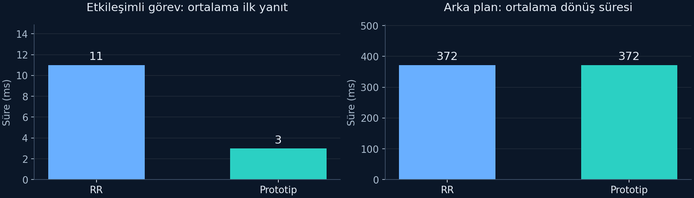
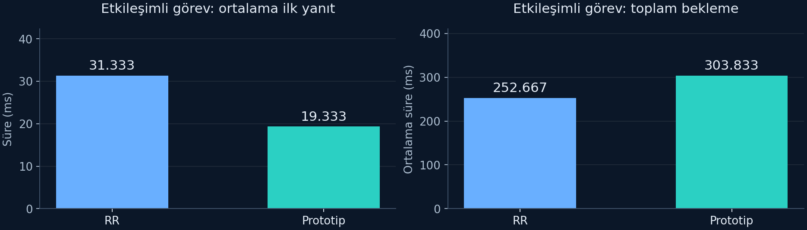

# 2209-A Proje Raporu

Gönderilen sonuç raporu şablonu esas alınmıştır. Rapor kapsamı: 9 Kasım 2026 itibarıyla mevcut çalışma aşaması. Bu belge, tamamlanan faaliyetleri ve gelecekte yapılacak çalışmaları ayırır; bitmiş ve onaylanmış proje beyanı değildir.

## GENEL BİLGİLER

| Alan | Bilgi |
| --- | --- |
| Projenin konusu | Etkileşimli Görevlerde Yanıt Süresini İyileştirmeye Yönelik Bütçe ve Yaşlandırma Tabanlı CPU Zamanlama Politikasının Geliştirilmesi |
| Proje yürütücüsü | Burak Şanlı |
| Üniversite / bölüm | Harran Üniversitesi / Bilgisayar Mühendisliği |
| Öğrenci numarası | 210504018 |
| Danışman | Prof. Dr. Dursun Akaslan |
| Proje başlangıç ve bitiş tarihleri | Resmî başlangıç ve bitiş tarihleri henüz kesinleşmedi. Planlanan çalışma süresi: 6 ay. |
| Rapor kapsam tarihi | 9 Kasım 2026 |
| Bildirilen gerçekleşen gider | Kullanıcı beyanına göre 0 TL |

# Giriş

Bu rapor, Burak Şanlı tarafından Harran Üniversitesi Bilgisayar Mühendisliği Bölümünde, Prof. Dr. Dursun Akaslan danışmanlığında yürütülen CPU zamanlama çalışmasının 9 Kasım 2026 itibarıyla ulaştığı teknik aşamayı açıklamaktadır. Çalışma, öğrencinin bireysel bitirme projesidir. Araştırmanın odağı, CPU yoğun arka plan işleriyle birlikte çalışan kısa ve etkileşimli işlerin ilk yanıt gecikmesini azaltabilecek bir zamanlama politikasının geliştirilmesi ve kontrollü deneylerle değerlendirilmesidir.

Rapor; uygulanmış prototipi, doğrulama testlerini ve alınmış başlangıç ölçümlerini kapsar. Çekirdek entegrasyonu ve kapsamlı karşılaştırmalı deneyler henüz tamamlanmamıştır. Bu nedenle sunulan bulgular, bitmiş bir çekirdek zamanlayıcısının başarısı veya Linux'un mevcut zamanlayıcısına karşı elde edilmiş performans üstünlüğü olarak değerlendirilmemelidir. Resmî proje başlangıç ve bitiş tarihleri henüz kesinleşmemiştir; altı aylık takvim, kalan araştırma faaliyetleri için önerilen çalışma süresidir.

# Proje konusu hakkında kısa bilgi

CPU zamanlayıcısı, çalışmaya hazır görevlerin işlemciyi hangi sırayla ve ne kadar süreyle kullanacağını belirler. Uzun hesaplamaların ilerlemesi ile kısa görevlerin hızlı yanıt vermesi birlikte gözetilmelidir. Yalnızca kısa görevleri öne almak, diğer görevlerde gecikme ve ilerleme kaybı oluşturabilir. Araştırma sorusu, etkileşimli görevlere sınırlı bir tercih tanıyan ve uzun bekleyen görevlere yaşlandırma uygulayan bir politikanın bu dengeyi hangi yük koşullarında iyileştirebildiğidir.

Araştırma iki tamamlayıcı araçla başlamıştır. `src/scheduler_sim.c`, politika kurallarını deterministik bir modelde karşılaştırır. `src/linux_baseline.c`, mevcut Linux zamanlayıcısı altında periyodik kısa işlerin zamanlamasını ölçer. İlk araç algoritmanın davranışını, ikinci araç gerçek işletim sistemindeki başlangıç koşullarını incelemektedir. Modelin referansı olan Round Robin, Linux'un varsayılan adil zamanlayıcısının birebir modeli değildir. İki aracın sonuçları bu nedenle doğrudan birbirinden çıkarılarak performans kazancı hesaplanamaz.

## Politikanın mevcut kuralları

Model, tek CPU ve bir milisaniyelik ayrık zaman adımları kullanır. Her görev tek bir CPU çalışma aralığına sahiptir. Girdi dosyalarının sütunları `id,class,arrival_ms,burst_ms` biçimindedir. Görev sınıfı `interactive` veya `background` olarak açıkça verilir; otomatik sınıflandırma uygulanmamıştır.

| Parametre | Varsayılan değer | İşlev |
| --- | --- | --- |
| Zaman dilimi | 4 ms | Bir seçimdeki normal çalışma süresini sınırlar. |
| Bütçe penceresi | 20 ms | Etkileşimli tercih bütçesinin yenilenme aralığıdır. |
| Etkileşimli tercih bütçesi | 8 ms | Pencere içindeki öncelikli etkileşimli çalışmayı sınırlar. |
| Yaşlandırma eşiği | 20 ms | Hazır durumda uzun bekleyen görevlerin seçimini destekler. |

Bütçe mevcutken etkileşimli sınıf, bütçe tükendiğinde ve arka plan görevi hazırken arka plan sınıfı tercih edilir. Sınıf içinde kuyruk sırası ve zaman dilimi uygulanır. Yaşlandırma, seçim anında görevin son yeniden kuyruğa girişinden beri beklediği süreye bakar; eşik aşılmışsa normal sınıf tercihini geçersiz kılabilir. Eşitliklerde kuyruk sırası kullanılır. Yaşlandırma ve başka sınıfta hazır görev bulunmaması istisnaları nedeniyle bütçe, kesin bir CPU payı garantisi değildir. Kullanılmayan bütçe sonraki pencereye aktarılmaz. Yeni görev gelişi veya pencere yenilenmesi tek başına çalışan görevi kesmez. Bütçe sıfıra indiğinde çalışan etkileşimli görev ve hazır arka plan görevi varsa, sonraki 1 ms adımında zaman dilimi bitmeden yeniden seçim yapılır; yaşlandırma ise ancak seçim anında uygulanır.

Modelde I/O beklemeleri, çok çekirdekli yerleştirme, CPU göçü ve bağlam değiştirme maliyeti bulunmaz. Bu sadeleştirmeler, politika kararlarının izlenebilirliğini sağlar; gerçek çekirdekteki davranışın ayrıca ölçülmesini gerektirir. Teknik dayanaklar arasında Linux çekirdeğinin `sched_ext` belgesi [K3] ve `tools/sched_ext/scx_simple` örneği [K4] bulunmaktadır. Adil sınıfın CFS ve EEVDF açıklamaları [K1–K2], referans davranışın kavramsal dayanağıdır; bu belgeler mevcut modelin Linux ile özdeş olduğunu göstermez. Kullanılacak çekirdek sürümü ve programlama arayüzü entegrasyon öncesinde sabitlenecektir.

# Rapor dönemlerinde yapılan çalışmalar

## Konu belirleme ve uygulama altyapısı

İlk haftada problem, amaç ve yöntem seçenekleri belirlenmiş; özgün konu seçimi PDF'i haftalık belge düzeninde korunmuştur. İkinci haftada C prototipi, Linux ölçüm programı, örnek iş yükleri, otomatik testler ve deney çalıştırma betiği hazırlanmıştır. Kaynak kodlar `src`, iş yükleri `workloads`, testler `tests`, çalıştırma betikleri `scripts` altında tutulmaktadır. `docs/hafta2/deney_sonuclari.md` bulguları açıklar; `experiments/hafta2/2026-11-05` dizini tarihli deney kayıtlarını barındırır.

`Makefile` derleme ve test adımlarını, `scripts/run_experiments.py` ise model ve Linux deneylerinin düzenli çalıştırılmasını destekler. Git sürüm geçmişi, kaynak kod değişikliklerinin ve belge güncellemelerinin izlenmesini sağlar. Derlenmiş yürütülebilir dosyalar yerine kaynak kodlar, komutlar ve sonuç kayıtları temel alınmaktadır.

## Doğrulama ve çalışma ortamları

Otomatik testlerde 13 test başarıyla tamamlanmıştır. Testler; sonuçların beklenen zamanlama davranışıyla uyumunu, girdi denetimini ve politika sınırlarını inceleyen tekrar çalıştırılabilir denetimlerdir. Bu sayı, çekirdek entegrasyonunun veya bütün olası iş yüklerinin doğrulandığı anlamına gelmez.

5 Kasım 2026 tarihli bulut deneyleri Debian 13, Linux 6.18.57 ve GCC 14.2 ortamında gerçekleştirilmiştir. Öğrencinin 9 Kasım tarihli yerel doğrulamasında Windows üzerinde model çıktıları alınmış, Ubuntu/WSL içinde C derlemesi ve 13 testin geçişi görülmüştür. Yerel bilgisayar Intel Core i7-12650H işlemci ve yaklaşık 15,7 GiB RAM içermektedir. Bulut çekirdeği sürümü, yerel WSL çekirdeği sürümü olarak kullanılmamaktadır. İki ortamdan gelen sonuçlar ayrı deney bağlamlarıdır.

## Model deneyleri ve ölçütler

Üç iş yükü, iki politika ile çalıştırılarak altı model deneyi elde edilmiştir. İlk yanıt süresi, ilk CPU başlangıcı ile geliş zamanı arasındaki farktır. Tamamlanma süresi, bitiş ile geliş arasındaki farktır. Toplam bekleme, tamamlanma süresinden CPU çalışma ihtiyacının çıkarılmasıyla hesaplanır. İlk yanıt ile toplam bekleme farklı davranışları gösterdiğinden birlikte değerlendirilmiştir.

| İş yükü | Yapı | RR ortalama ilk yanıt | Önerilen politika ortalama ilk yanıt |
| --- | --- | ---: | ---: |
| Yalnız CPU | Başlangıçta gelen üç adet 120 ms arka plan görevi | Etkileşimli görev yok | Etkileşimli görev yok |
| Karışık | Üç adet 120 ms arka plan ve sekiz adet 2 ms etkileşimli görev | 11 ms | 3 ms |
| Etkileşimli baskı | Üç adet 80 ms arka plan ve on iki adet 20 ms etkileşimli görev | 31,333 ms | 19,333 ms |

Karışık yükte etkileşimli görevler 5, 15, 25 milisaniye biçiminde, 75 milisaniyeye kadar gelir. İlk yanıtın 11 milisaniyeden 3 milisaniyeye düşmesi, bu belirli modelde yaklaşık %72,7 azalmadır. Etkileşimli görevlerin ortalama tamamlanması 13 milisaniyeden 5 milisaniyeye iner. İki politikada da son görev 376 milisaniyede tamamlanır; arka plan görevlerinin ortalama tamamlanma süresi 372 milisaniyedir. Bununla birlikte üçüncü arka plan görevinin ilk başlangıcı 8 milisaniyeden 10 milisaniyeye kayar. Kazancın yanında bu maliyet de raporlanmıştır.

Etkileşimli baskı yükü önemli bir karşı örnek üretmiştir. İlk yanıt ortalaması 31,333 milisaniyeden 19,333 milisaniyeye iyileşirken etkileşimli görevlerin ortalama toplam beklemesi 252,667 milisaniyeden 303,833 milisaniyeye yükselir. Ortalama tamamlanma 272,667 milisaniyeden 323,833 milisaniyeye çıkar. Dolayısıyla erken ilk yanıt, bütün işlerin daha erken bitmesi anlamına gelmez. Politika değerlendirmesinde olumsuz koşulların da görünür tutulması gerektiği bu deneyle gösterilmiştir.

Şekil 1. 5 Kasım model arşivinden üretilmiştir. Milisaniye cinsinden model karşılaştırmasıdır; gerçek Linux politika kazancı değildir.

Şekil 2. İlk yanıt iyileşirken toplam beklemenin artabildiği karşı örnek, iki ölçütle birlikte gösterilmiştir.

## Gerçek Linux başlangıç ölçümleri

Ölçüm programı, izin verilen en düşük numaralı mantıksal CPU'ya bağlanır. Arka plan çalışanları aynı CPU bağını devralır. Ana süreç, 20 milisaniyelik dönemlerle 40 kısa CPU işi gerçekleştirir; bunlar 40 ayrı yeni süreç değildir. Her kısa işin CPU zamanı hedefi 500 mikrosaniyedir. Arka plan çalışanlarının her biri 800 milisaniyelik CPU zamanı tüketir. Gerçek zamanlayıcı sınıfı `SCHED_OTHER` olarak doğrulanır; özel politika yüklenmez.

Program, mutlak uyanma hedefleri için `CLOCK_MONOTONIC`, CPU tüketimini izlemek için `CLOCK_PROCESS_CPUTIME_ID` kullanır. Uyanma gecikmesi, planlanan zaman ile uyku çağrısından kullanıcı alanına dönüş arasındaki farktır. Bu değer saf çalışmaya hazır kuyruk gecikmesi değildir; zamanlayıcılar, sistem yükü ve sanallaştırma da etkili olabilir. CPU zamanına göre sınırlandırılmış döngü, sabit hesaplama işi üzerinden yapılan bir iş hacmi ölçümü olarak yorumlanmaz.

| Tekrar | Arka plan çalışanı | Ortalama uyanma gecikmesi | P95 | En yüksek |
| --- | ---: | ---: | ---: | ---: |
| 1 | 0 | 0,165 ms | 0,289 ms | 0,414 ms |
| 1 | 2 | 1,095 ms | 2,821 ms | 3,341 ms |
| 2 | 0 | 0,109 ms | 0,129 ms | 0,158 ms |
| 2 | 2 | 1,123 ms | 2,969 ms | 3,215 ms |
| 3 | 0 | 0,134 ms | 0,166 ms | 0,665 ms |
| 3 | 2 | 1,100 ms | 2,772 ms | 3,204 ms |

Altı çalıştırma toplam 240 kısa iş gözlemi üretmiştir. P95, her 40 gözlem içinde sıralı 38. değerdir; en kötü durum garantisi değildir. Yüklü çalıştırmalarda daha yüksek gecikmeler gözlenmiştir. Ancak yalnızca üç tekrar yapılması, sıralamanın her tekrarda önce yüksüz sonra yüklü olması ve ortam etkileri, güçlü genellemeleri sınırlar. Bu tablo, önerilen politikanın Linux'a karşı karşılaştırması değildir.

## Yeniden üretim ve veri bütünlüğü

Kaynak kodun sürümü, derleme seçenekleri, girdi CSV'leri ve politika parametreleri kaydedilmektedir. Modelde görev i için ilk yanıt `R_i = start_i − arrival_i`, tamamlanma `T_i = finish_i − arrival_i`, toplam bekleme `W_i = T_i − burst_i` eşitlikleriyle hesaplanır. CPU boşluğu yokken bu sonlu yüklerde son bitişin toplam CPU ihtiyacına eşit olması, modele ait bir tutarlılık kontrolüdür; gerçek sistemde işlem hacmi artışı değildir.

Linux üzerinde depo kökünde `make`, `make test` ve `make experiment` sırasıyla derleme, doğrulama ve yeni veri toplama adımlarıdır. Yeni ölçümler `results/` dizinine yazılır; 5 Kasım arşivi değiştirilmez. Arşiv içinde `sha256sum -c sha256sums.txt` komutu kayıt bütünlüğünü denetler. Yeni gerçek zaman ölçümlerinin eski gecikme sayılarıyla birebir aynı olması beklenmez. Öğrencinin bilgisayarı için PowerShell/Ubuntu komut ayrımı ve canlı gösterim adımları `docs/hafta2/calistirma_ve_canli_gosterim.md` belgesindedir.

## Kalan araştırma faaliyetleri

| Dönem | Planlanan faaliyet | Doğrulanacak çıktı |
| --- | --- | --- |
| Ay 1 | Yalıtılmış konuk sistem, çekirdek özellikleri, araçlar ve kurtarma hazırlığı | Örnek zamanlayıcının üç yükleme–kaldırma–geri dönüş denemesi |
| Ay 2 | Model, sınıflandırma ve iş yüklerinin genişletilmesi | Belgelenmiş politika sınırları ve ek doğrulamalar |
| Ay 3–4 başlangıcı | `sched_ext`/BPF üzerinden çekirdek uygulaması | Toplam en az 25 test ve kontrol senaryosu hedefi |
| Ay 4 sonu–5 | Eşleştirilmiş ana karşılaştırmalar | 120 planlı çalıştırmanın kayıtları |
| Ay 6 | Duyarlılık, bileşen etkileri ve olumsuz koşullar | 60 ek çalıştırma ve bütünleşik değerlendirme |

Planlanan konuk sistem başlangıçta iki sanal CPU ve 4 GiB RAM kullanacak; ölçülen görevler tek konuk CPU'sunda sabitlenecektir. Donanım hızlandırması ve gerekli çekirdek özellikleri önceden doğrulanacaktır. Farklı sanallaştırma arka uçlarından alınan veriler birleştirilmeyecektir. Çekirdek uygulamasında bütçe gerçek CPU çalışma süresine, pencere duvar saatine dayanacak; modeldeki milisaniyelik döngü yerine çekirdek olayları kullanılacaktır. Görevler deney başlamadan açıkça kaydedilecek, başlangıç eşitlemesi uygulanacak ve hata durumunda varsayılan zamanlayıcıya dönüş denetlenecektir.

Ana deney tasarımı üç yük ailesi, iki yoğunluk, on eşleştirilmiş blok ve iki politika içerir: toplam 120 çalıştırma. Yalnız CPU deneyleri sabit hesaplama işinin tamamlanmasını; dört karışık yük koşulu en az biner kısa gözlemle gecikme ve arka plan ilerlemesini inceleyecektir. Arka plan işleri bütün gözlem penceresi boyunca çalışacaktır. Çalıştırma sırası dengelenecek, çekirdek ve kaynak ayarları sabit tutulacaktır. Öncelikli hedef, 20 milisaniye dönemli karışık yükte P95'i en az %20 azaltırken arka plan ilerleme kaybını %10 içinde tutmak ve hiçbir arka plan işçisinin gözlem penceresi boyunca tamamen ilerlemesiz kalmamasını sağlamaktır. Bunlar henüz gerçekleşmemiş başarı ölçütleridir.

Ek 60 çalıştırmada FIFO kipinde `scx_simple`, yaşlandırmasız politika ve bütçe üst sınırı kaldırılmış politika karşılaştırılacaktır. Tasarım, iki karma yük periyodu (20 ms ve 2 ms), üç ek kontrol, beş eşleştirilmiş blok ve iki koşu içerir: `2 × 3 × 5 × 2 = 60`. Sonuçlar tekrar blokları üzerinden değerlendirilecek; tek bir çalıştırmanın bin gözlemi bağımsız bin deney sayılmayacaktır. Pilot ve izleme maliyeti deneyleri ayrı kaydedilecektir. Her gecikme koşusunda en az 1.000 örnek; 20 ms periyotlu koşulda yaklaşık 20 saniyelik gözlem hedeflenir; CPU-only koşularında kısa iş örneği şartı bulunmaz. Arka plan ilerlemesi, sabit bir pencerede tamamlanan eşdeğer iş birimleriyle; saf CPU koşullarındaki işlem hacmi ise sabit işin duvar saati tamamlanma süresiyle değerlendirilecektir. CPU zamanı bütçesiyle sınırlandırılmış mevcut ölçüm, bu sabit iş deneyiyle karıştırılmayacaktır.

P95 iyileşme yüzdesi `100 × (P95_varsayılan − P95_özel) / P95_varsayılan` ile hesaplanacaktır; varsayılan P95 sıfırsa göreli oran yerine mutlak fark kullanılacaktır. Arka plan ilerleme kaybı ise aynı koşuldaki iş birimleri üzerinden hesaplanacaktır. Eşleştirilmiş blok farkları, medyan ve dağılımlar raporlanacak; güven aralığı hesaplanırsa yeniden örnekleme birimi koşu/blok olacaktır. Tek tek kısa gözlemler bağımsız tekrar olarak kabul edilmeyecektir. Politika maliyetine ilişkin göstergeler, aynı yükte harcanan CPU zamanı ve saniye başına bağlam değişimiyle ayrıca izlenecektir. Bu toplam göstergelerden tek başına kesin BPF yürütme süresi çıkarılmayacaktır. Beklenen P95 kazancı görülmezse veya ilerleme kaybı sınırı aşılırsa sonuç olumsuz bulgu olarak korunacaktır.

## Riskler, alternatifler ve tamamlanma ölçütleri

| Risk | İzlenecek yaklaşım | Kayıt / karar ölçütü |
| --- | --- | --- |
| WSL/konuk çekirdeğinde gerekli BPF, BTF veya sched_ext özelliklerinin bulunmaması | Destekleyen sürümü sabitlenmiş ayrı konuk çekirdeği ve uygun araç zinciri hazırlanması | Çekirdek yapılandırması, araç sürümleri ve örnek yükleme kaydı |
| Donanım hızlandırmasının kullanılamaması | Gerekirse yazılım öykünmesi/TCG ile daha yavaş ama aynı konuk üzerinde çalışma | Karşılaştırmanın iki kolunda aynı arka uç; farklı arka uç sonuçları birleştirilmez |
| BPF doğrulayıcı hatası, kilitlenme veya politikanın durdurulması | Önce örnek politika, ardından kademeli uygulama; konsol ve varsayılan politikaya dönüş denemeleri | Üç yükleme–kaldırma–geri dönüş denemesi ve hata günlükleri |
| Yanlış sınıflandırma, arka planın aşırı beklemesi veya ölçüm kaybı | Açık görev kaydı, yaşlandırma/bütçe kontrolü ve başarısız koşuların saklanması | Görev ilerlemesi, eksik örnek oranı ve durdurma nedeni |
| Ortam gürültüsü ve koşul sırası yanlılığı | Dengeli eşleştirilmiş sıra, ayrı pilotlar, sabit kaynaklar ve koşu bazında özet | Ortam manifesti ve önceden tanımlanmış dışlama gerekçeleri |

Bu aşamalar henüz uygulanmış olarak sunulmamaktadır. Çekirdek entegrasyonu tamamlanamazsa yalnız model sonuçları çekirdek başarısı yerine geçirilmeyecek; erişim engeli, başarısız denemeler ve teslim kapsamı açıkça raporlanacaktır. Planın tamamlanması; politika kaynağı, test günlükleri, eşleştirilmiş ham deney kayıtları, analiz çıktıları, yeniden üretim kılavuzu ve sınırlılıkların birlikte teslimiyle değerlendirilecektir.

# Sonuç

Mevcut aşamada çalışan ve test edilebilir bir politika modeli, Linux başlangıç ölçüm aracı ve izlenebilir deney arşivi oluşturulmuştur. Karışık yükte ilk yanıt iyileşmesi görülürken baskılı yükte toplam beklemenin kötüleşmesi, hedeflerin tek ölçüte indirgenmemesi gerektiğini ortaya koymuştur. İlk iki haftanın katkısı, araştırma fikrini somut kod, ölçüm ve sorgulanabilir bulgulara dönüştürmektir.

Çalışmanın tamamlanması için özel politikanın çekirdekte uygulanması, güvenli geri dönüşün doğrulanması ve aynı ortamda varsayılan Linux davranışıyla karşılaştırılması gerekmektedir. Mevcut sonuçlar gerçek zaman garantisi, mutlak adalet, bütün iş yüklerinde üstünlük veya aç kalmanın matematiksel olarak önlendiği iddialarını desteklememektedir. Son değerlendirme, kazanımların yanında arka plan ilerlemesi, toplam bekleme ve uygulama maliyetlerini birlikte içerecektir.

# Çıktılar (Yayınlar,sunumlar v.b.)

Mevcut çıktılar; iki C programı, otomatik test takımı, üç örnek CSV iş yükü, deney çalıştırma betiği, ham ölçümler, özet tablolar, teknik kod rehberi ve haftalık belgelerdir. Birinci haftanın özgün konu seçimi PDF'i ile ikinci haftanın 18 slaytlık değerlendirme sunumu arşivlenmiştir. Araştırma önerisi belgeleri, planlanan tam proje kapsamını ayrıca açıklar.

Kodlar ve belgeler `https://github.com/sanlibrk/Kernel_CPU` adresinde sürüm geçmişiyle yayımlanmaktadır. Henüz hakemli makale, kabul edilmiş bildiri veya bilimsel etkinlikte gerçekleştirilmiş sunum bildirilmemiştir. Yeni bir yayın veya tamamlanmış çekirdek uygulaması mevcut çıktı olarak gösterilmemektedir.

## Kullanılan teknik kaynaklar ve kanıt kayıtları

[K1] Linux Kernel Community (2024). CFS Scheduler, Linux v6.12: https://github.com/torvalds/linux/blob/v6.12/Documentation/scheduler/sched-design-CFS.rst

[K2] Linux Kernel Community (2024). EEVDF Scheduler, Linux v6.12: https://github.com/torvalds/linux/blob/v6.12/Documentation/scheduler/sched-eevdf.rst

[K3] Linux Kernel Community (2024). Extensible Scheduler Class, Linux v6.12: https://github.com/torvalds/linux/blob/v6.12/Documentation/scheduler/sched-ext.rst

[K4] Linux Kernel Community (2024). scx_simple BPF örneği, Linux v6.12: https://github.com/torvalds/linux/blob/v6.12/tools/sched_ext/scx_simple.bpf.c

[K5] Kernel_CPU proje arşivi (5 Kasım 2026): `experiments/hafta2/2026-11-05/summary.json`, altı model CSV'si, altı Linux JSON'u, `tests.txt` ve `sha256sums.txt`. Sonuç tabloları bu kayıtlara dayanmaktadır.

[K6] Yerel çalıştırma kayıtları (9 Kasım 2026, kullanıcı paylaşımı): Windows model çıktıları, Ubuntu/WSL derleme ve test çıktıları, işlemci ve bellek envanteri. Yerel tam deney grubunun ham çıktısı henüz paylaşılmamıştır.

# Proje ile ilgili harcama kalemleri hakkında ayrıntılı bilgi

Yürütücünün beyanına göre rapor tarihi itibarıyla proje kapsamında gerçekleşmiş harcama yoktur; bildirilen toplam gider 0 TL'dir. Donanım alımı, ücretli yazılım lisansı, ücretli test hizmeti, seyahat veya sarf malzemesi gideri bildirilmemiştir. Mevcut bilgisayar ve erişilebilen yazılım olanakları kullanılmaktadır. Derleyici, Python, Git, Linux ve planlanan açık kaynak geliştirme araçları için ücretli lisans öngörülmemektedir.

Mevcut plan için talep edilen ek gider 0 TL'dir. Bu ifade, araştırmanın tamamlandığı veya gelecekte hiçbir gereksinim oluşmayacağı anlamına gelmez. Henüz gerçekleşmemiş satın alma, destek ödemesi, mali kapanış veya harcama belgesi mevcutmuş gibi gösterilmemiştir. Kaynak gereksinimi değişirse gerekçe ve gerçekleşen giderler ilgili dönemde ayrıca belgelenecektir.

## İmza alanları

Proje yürütücüsü: Burak Şanlı. Danışman: Prof. Dr. Dursun Akaslan. İmzalar ve imza tarihi tamamlanmamıştır; Word şablonunda imza alanları boş bırakılmıştır.
